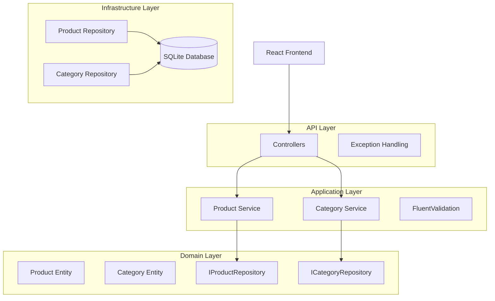

# 01 - Clean Architecture Product Catalog API

A production-style .NET 9 Web API demonstrating Clean Architecture, SOLID principles, and modern engineering practices.

[← Back to Portfolio](../)

## Overview

This project implements a Product Catalog system with CRUD operations, pagination, search, sorting, and category filtering. It serves as a portfolio demonstration of:

- Clean Architecture (Onion Architecture)
- SOLID principles
- ASP.NET Core Web API
- Entity Framework Core
- FluentValidation
- Unit and Integration Testing
- React + TypeScript Frontend
- Docker Containerization

## Architecture

```
src/
├── ProductCatalog.Domain          # Entities, Interfaces, Business Rules
├── ProductCatalog.Application     # Services, DTOs, Validators
├── ProductCatalog.Infrastructure  # EF Core, Repositories, Middleware
└── ProductCatalog.API             # Controllers, Configuration

tests/
├── ProductCatalog.UnitTests       # Business logic tests
└── ProductCatalog.IntegrationTests # API endpoint tests

frontend/
└── productcatalog-ui              # React + TypeScript + Vite
```

**Dependency Direction**: API → Application → Domain ← Infrastructure

The Domain layer has **zero** dependencies on infrastructure. Interfaces defined in Domain are implemented by Infrastructure.



## Key Design Decisions

| Decision | Rationale |
|----------|-----------|
| Domain has no dependencies | Business logic is pure and testable |
| Repository pattern | Abstracts data access, enables mocking |
| FluentValidation | Declarative validation rules |
| Separate test projects | Unit tests fast, integration tests realistic |
| React frontend | Modern SPA with TypeScript safety |

## API Endpoints

| Method | Endpoint | Description |
|--------|----------|-------------|
| GET | `/api/products` | List products (paginated, filterable) |
| GET | `/api/products/{id}` | Get product by ID |
| POST | `/api/products` | Create product |
| PUT | `/api/products/{id}` | Update product |
| DELETE | `/api/products/{id}` | Delete product |
| GET | `/api/categories` | List categories |
| POST | `/api/categories` | Create category |

## Tech Stack

- .NET 9
- Entity Framework Core 9 (SQLite)
- FluentValidation
- xUnit + FluentAssertions + Moq
- React 19 + TypeScript + Vite
- Docker

## Source Code

Full implementation: [`01-clean-architecture-product-api/`](../../01-clean-architecture-product-api/)
