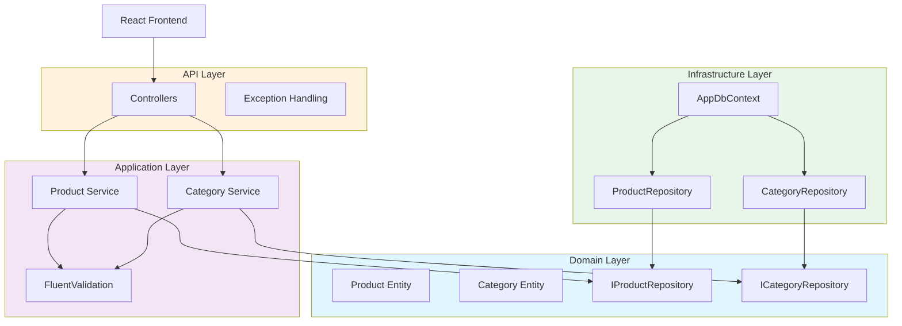

# Clean Architecture Product Catalog API

A production-style .NET 9 Web API demonstrating Clean Architecture, SOLID principles, and modern engineering practices.

## Overview

This project implements a Product Catalog system with CRUD operations, pagination, search, sorting, and category filtering. It serves as a portfolio demonstration of:

- Clean Architecture (Onion Architecture)
- SOLID principles
- ASP.NET Core Web API
- Entity Framework Core
- FluentValidation
- Unit and Integration Testing
- React + TypeScript Frontend
- Docker Containerization

## Architecture

```
src/
├── ProductCatalog.Domain          # Entities, Interfaces, Business Rules
├── ProductCatalog.Application     # Services, DTOs, Validators
├── ProductCatalog.Infrastructure  # EF Core, Repositories, Middleware
└── ProductCatalog.API             # Controllers, Configuration

tests/
├── ProductCatalog.UnitTests       # Business logic tests
└── ProductCatalog.IntegrationTests # API endpoint tests

frontend/
└── productcatalog-ui              # React + TypeScript + Vite
```

**Dependency Direction**: API → Application → Domain ← Infrastructure

The Domain layer has **zero** dependencies on infrastructure. Interfaces defined in Domain are implemented by Infrastructure.

### Mermaid Diagram



## Features

### API Endpoints

| Method | Endpoint | Description |
|--------|----------|-------------|
| GET | /api/products | List products with pagination, search, sorting |
| GET | /api/products/{id} | Get product by ID |
| POST | /api/products | Create new product |
| PUT | /api/products/{id} | Update product |
| DELETE | /api/products/{id} | Delete product |
| GET | /api/categories | List all categories |
| POST | /api/categories | Create category |
| GET | /health | Health check endpoint |

### Query Parameters

- `page` (default: 1)
- `pageSize` (default: 10)
- `search` - Search by name or description
- `sortBy` - Sort by name, price, or createdat
- `sortDescending` (default: false)
- `categoryId` - Filter by category

### Business Rules

- Product names must be unique
- Product price must be greater than 0
- Products must belong to a valid category
- Category names must be unique

## SOLID Principles

| Principle | Implementation |
|-----------|----------------|
| **S**ingle Responsibility | Each service handles one aggregate |
| **O**pen/Closed | Services extend via interfaces |
| **L**iskov Substitution | Repository implementations are interchangeable |
| **I**nterface Segregation | Separate interfaces for Product and Category |
| **D**ependency Inversion | Domain defines interfaces, Infrastructure implements |

## Getting Started

### Prerequisites

- .NET 9 SDK
- Docker (optional)
- Node.js 18+ (for React frontend)

### Running with Docker

```bash
docker compose up
```

This starts:
- API on http://localhost:5000
- SQL Server on localhost:1433
- React frontend on http://localhost:3000

### Running Locally

**Backend:**
```bash
dotnet restore
dotnet run --project src/ProductCatalog.API
```

**Frontend:**
```bash
cd frontend/productcatalog-ui
npm install
npm run dev
```

The API runs on http://localhost:5000. Swagger is available at http://localhost:5000/swagger.

### Environment Variables

| Variable | Description | Default |
|----------|-------------|---------|
| `ConnectionStrings__DefaultConnection` | SQL Server connection string | Server=localhost;Database=ProductCatalogDb |
| `ASPNETCORE_ENVIRONMENT` | Environment name | Development |

## Testing

### Unit Tests
```bash
dotnet test tests/ProductCatalog.UnitTests
```

Tests business logic:
- FluentValidation rules
- ProductService operations
- Result pattern behavior
- PagedResult calculations

### Integration Tests
```bash
dotnet test tests/ProductCatalog.IntegrationTests
```

Tests API endpoints with in-memory database:
- CRUD operations
- HTTP status codes
- Request/Response contracts

## Key Design Decisions

See [docs/decisions/](docs/decisions/) for Architecture Decision Records:

- **ADR-001**: Clean Architecture adoption
- **ADR-002**: Result pattern for operations
- **ADR-003**: FluentValidation for input validation

## Interview Discussion Points

1. **Why Clean Architecture?**
   - Testability without mocking infrastructure
   - Business rules are framework-independent
   - Easy to swap databases or external services

2. **Why Repository Pattern?**
   - Abstracts data access
   - Enables unit testing with mocks
   - Follows Dependency Inversion Principle

3. **Why Result Pattern instead of Exceptions?**
   - Business rule violations are expected, not exceptional
   - Clear API response mapping
   - No performance overhead from exception handling

4. **How would you scale this?**
   - Add caching layer
   - Implement CQRS for read/write separation
   - Add message queue for async operations
   - Consider microservices for different bounded contexts

## Possible Improvements

- Add authentication/authorization
- Implement CQRS with MediatR
- Add Redis caching
- Implement API versioning
- Add OpenTelemetry for distributed tracing
- Add rate limiting
- Implement soft deletes

## License

MIT License - see [LICENSE](LICENSE)
