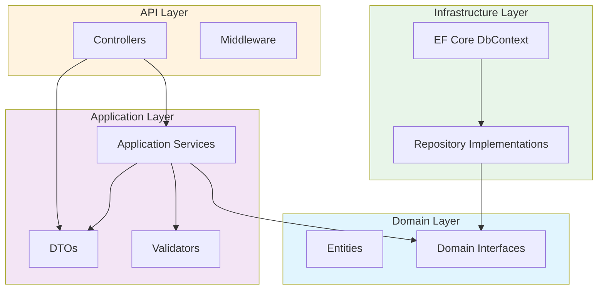

# Architecture

## Overview

This project demonstrates **Clean Architecture** (also known as Onion or Hexagonal Architecture) applied to a .NET 9 Web API for a Product Catalog system.

## Dependency Rule

The fundamental rule of Clean Architecture: **source code dependencies must point inward only**. Inner layers know nothing about outer layers.

```
┌─────────────────────────────────────────┐
│              API Layer                   │
│  Controllers, Middleware, Config         │
├─────────────────────────────────────────┤
│           Application Layer              │
│  Services, DTOs, Validators, Interfaces  │
├─────────────────────────────────────────┤
│           Domain Layer                   │
│  Entities, Domain Interfaces, Rules      │
├─────────────────────────────────────────┤
│         Infrastructure Layer             │
│  EF Core, Repositories, External APIs    │
└─────────────────────────────────────────┘
```

## Layer Responsibilities

### Domain Layer (`ProductCatalog.Domain`)
- **Zero dependencies** on other projects
- Contains business entities (`Product`, `Category`)
- Defines repository interfaces (contracts)
- Contains domain logic and business rules
- Should never reference EF Core, SQL, or any infrastructure

### Application Layer (`ProductCatalog.Application`)
- Depends only on Domain
- Contains DTOs (Data Transfer Objects)
- Contains FluentValidation validators
- Contains application services (business workflows)
- Defines service interfaces
- Uses Result pattern for operation outcomes

### Infrastructure Layer (`ProductCatalog.Infrastructure`)
- Depends on Application and Domain
- Implements repository interfaces from Domain
- Contains EF Core DbContext and configurations
- Contains middleware (exception handling, correlation ID)
- Implements external concerns (database, file system, APIs)

### API Layer (`ProductCatalog.API`)
- Depends on Application and Infrastructure
- Contains controllers (HTTP endpoints)
- Contains middleware configuration
- Contains DI registration
- Contains program configuration
- **Never contains business logic**

## Design Decisions

### Why Clean Architecture?

1. **Testability**: Business logic can be tested without UI or database
2. **Separation of Concerns**: Each layer has a single responsibility
3. **Flexibility**: UI, database, or external services can be swapped
4. **Maintainability**: Changes in one layer don't cascade

### Why Repository Pattern?

Repository interfaces are defined in Domain (innermost), implemented in Infrastructure (outermost). This allows:
- Mocking in unit tests
- Swapping database providers
- Keeping domain pure from data access concerns

### Why Result Pattern?

Instead of throwing exceptions for business rule violations, services return `Result<T>`:
- Explicit success/failure handling
- No exception overhead for expected failures
- Clear API responses

## Mermaid Diagram


