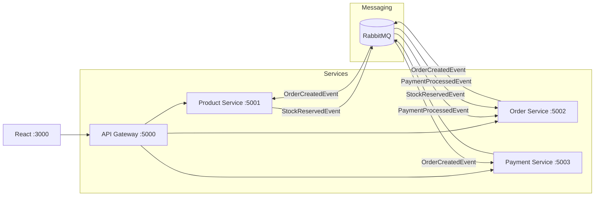
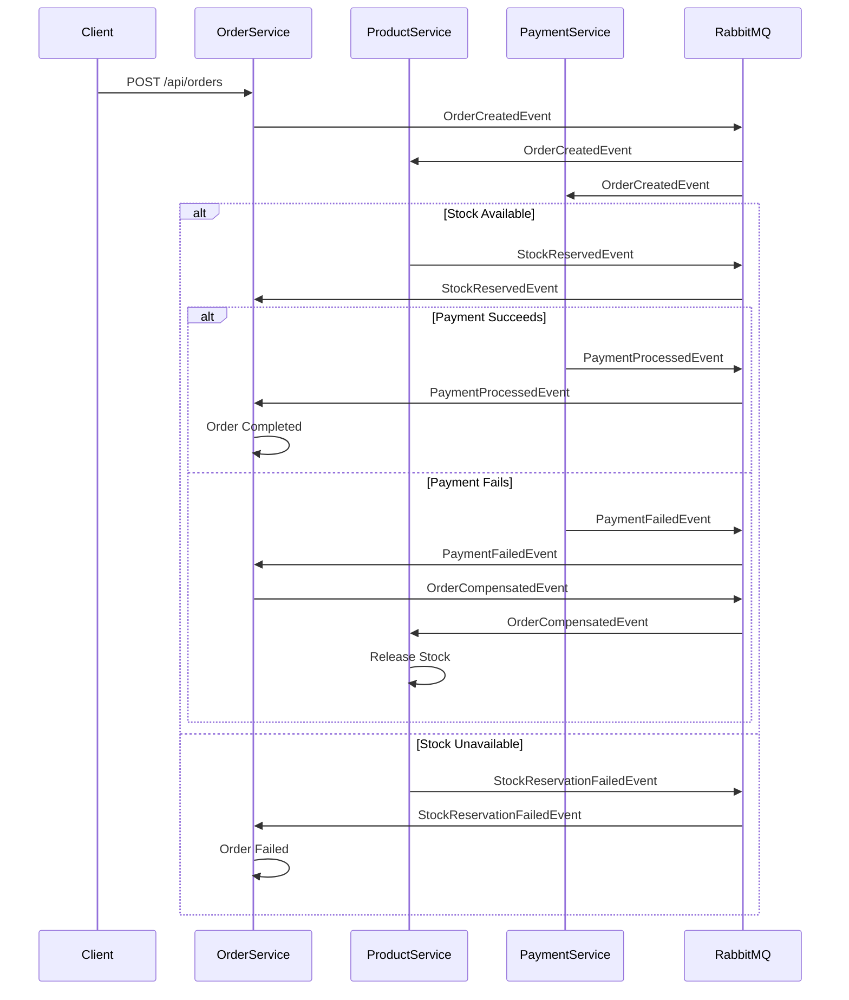

# 02 - Microservices with Saga Pattern

A distributed order processing system demonstrating microservices architecture with the Saga orchestration pattern.

[← Back to Portfolio](../)

## Overview

This project implements a complete microservices architecture with 4 independent services communicating via RabbitMQ. The order creation flow uses the Choreography-based Saga pattern with automatic compensation on failure.

- Saga Pattern (Choreography)
- Event-Driven Architecture
- Database Per Service
- API Gateway (YARP)
- Idempotent Consumers
- MassTransit + RabbitMQ

## Architecture

```
┌─────────────┐     ┌──────────────┐     ┌──────────────────┐
│   React     │────▶│  API Gateway │────▶│   Product Service │
│   Frontend  │     │  (YARP)      │     │   (REST + EventBus)│
└─────────────┘     └──────┬───────┘     └────────┬─────────┘
                           │                      │
                    ┌──────▼───────┐     ┌────────▼─────────┐
                    │              │     │   Order Service   │
                    │              │     │   (Saga Orchestrator)│
                    │              │     └────────┬─────────┘
                    └──────┬───────┘              │
                           │             ┌────────▼─────────┐
                    ┌──────▼───────┐     │ Payment Service  │
                    │   RabbitMQ   │◀───▶│ (Consumer)       │
                    └──────────────┘     └──────────────────┘
```



## Saga Flow

### Happy Path
```
CreateOrder → ReserveStock → ProcessPayment → CompleteOrder
```

### Compensation Path (Payment Fails)
```
CreateOrder → ReserveStock → ProcessPayment (FAIL) → Compensate → ReleaseStock
```



## Services

| Service | Port | Responsibility | Database |
|---------|------|---------------|----------|
| API Gateway | 5000 | YARP reverse proxy | - |
| Product Service | 5001 | Catalog & inventory | products.db |
| Order Service | 5002 | Order management & saga | orders.db |
| Payment Service | 5003 | Payment processing | payments.db |
| Frontend | 3000 | React SPA | - |
| RabbitMQ | 5672 | Message broker | - |

## Key Design Decisions

| Decision | Rationale |
|----------|-----------|
| Database per service | Independent deployability, data isolation |
| Choreography saga | Loose coupling, no single point of failure |
| MassTransit | Built-in retry, idempotency, consumer model |
| YARP gateway | Microsoft-supported, high performance |
| SQLite | Zero config, portable, demo-friendly |
| Idempotent consumers | Prevents duplicate processing |

## API Endpoints

### Product Service
| Method | Endpoint | Description |
|--------|----------|-------------|
| GET | `/api/products` | List products |
| GET | `/api/products/{id}` | Get product |
| POST | `/api/products` | Create product |

### Order Service
| Method | Endpoint | Description |
|--------|----------|-------------|
| GET | `/api/orders` | List orders |
| GET | `/api/orders/{id}` | Get order |
| POST | `/api/orders` | Create order (triggers saga) |
| GET | `/api/orders/{id}/saga` | Get saga execution logs |

## Tech Stack

- .NET 9, Minimal APIs
- MassTransit 9 + RabbitMQ
- Entity Framework Core 9 (SQLite)
- YARP Reverse Proxy
- React 19 + TypeScript + Vite
- Docker + Docker Compose
- xUnit + FluentAssertions + Moq

## Source Code

Full implementation: [`04-dotnet-microservices-grpc-saga/`](../../04-dotnet-microservices-grpc-saga/)
