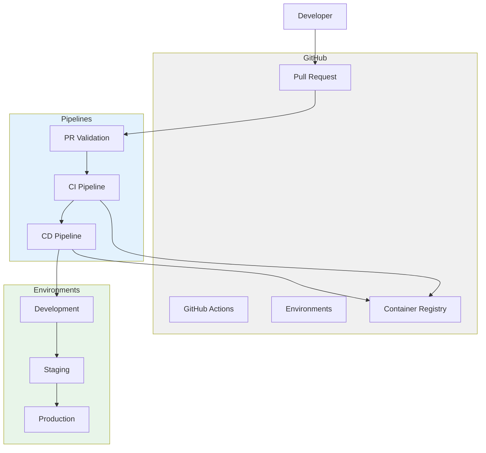
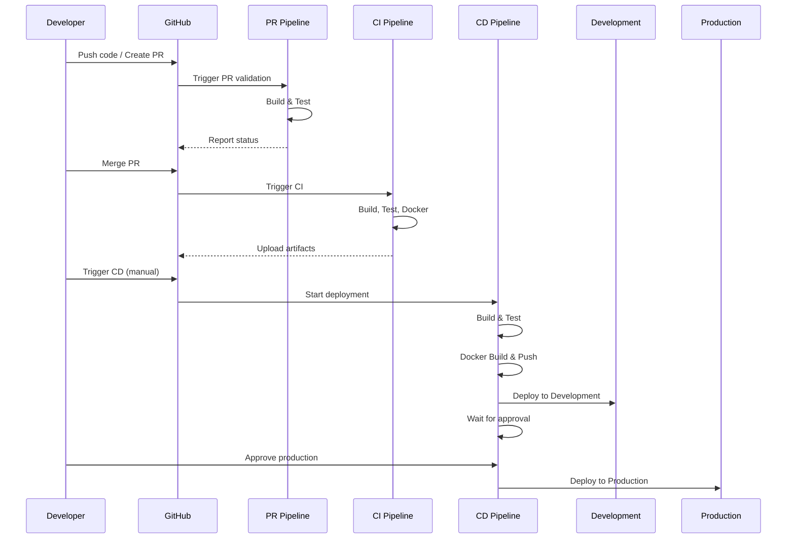

# GitHub Actions CI/CD - Order API

A production-style .NET 9 Order Management API demonstrating CI/CD implementation with GitHub Actions.

## Overview

This project demonstrates practical CI/CD implementation using GitHub Actions. It includes:

- Pull Request validation pipeline
- Continuous Integration pipeline
- Continuous Deployment pipeline with environment promotion
- Docker containerization
- GitHub Environments with approval gates

## Architecture



## Project Structure

```
02-github-actions-cicd/
├── .github/
│   └── workflows/
│       ├── pull-request.yml    # PR validation
│       ├── ci.yml              # Continuous Integration
│       └── cd.yml              # Continuous Deployment
├── src/
│   └── OrderApi/
│       ├── Controllers/        # API endpoints
│       ├── Data/               # EF Core DbContext
│       ├── DTOs/               # Data Transfer Objects
│       ├── Middleware/          # Exception handling
│       └── Models/             # Entities
├── tests/
│   └── OrderApi.Tests/         # Unit tests
├── docs/
│   └── decisions/              # ADRs
├── Dockerfile                  # Multi-stage build
├── docker-compose.yml          # Local development
└── README.md
```

## CI/CD Pipelines

### Pull Request Validation (`pull-request.yml`)

Triggered on: `pull_request` to `main`

```yaml
Steps:
1. Checkout code
2. Setup .NET 9
3. Restore dependencies
4. Build (Release)
5. Run unit tests
6. Upload test results
7. Check code formatting
```

**Purpose**: Ensure code quality before merging.

### CI Pipeline (`ci.yml`)

Triggered on: `push` to `main`

```yaml
Steps:
1. Checkout code
2. Setup .NET 9
3. Restore dependencies
4. Build (Release)
5. Run unit tests
6. Upload test results
7. Publish application
8. Upload publish artifact
9. Build Docker image
10. Save Docker image artifact
```

**Purpose**: Build and test on every merge to main.

### CD Pipeline (`cd.yml`)

Triggered on: `workflow_dispatch` (manual)

```yaml
Stages:
1. Build & Test
2. Docker Build & Push
3. Deploy Development (auto)
4. Approval Gate
5. Deploy Production (manual approval)
6. Rollback (on failure)
```

**Purpose**: Deploy to environments with approval gates.

## Mermaid Pipeline Diagram



## GitHub Environments

### Development
- Auto-deploy on CI success
- No approval required
- Uses `development` environment

### Production
- Manual approval required
- Uses `production` environment
- Requires approval from designated reviewers

### Configuration

In GitHub repo settings:
1. Go to Settings → Environments
2. Create `development` environment
3. Create `production` environment
4. Add required reviewers to `production`
5. Add secrets for deployment credentials

## Secrets Management

### Required Secrets

| Secret | Description | Environment |
|--------|-------------|-------------|
| `DOCKER_REGISTRY_URL` | Container registry URL | All |
| `DOCKER_REGISTRY_USERNAME` | Registry username | All |
| `DOCKER_REGISTRY_PASSWORD` | Registry password | All |
| `DEPLOYMENT_SSH_KEY` | SSH key for deployment | All |
| `AZURE_CREDENTIALS` | Azure service principal | Production |

### Setting Secrets

1. Go to Settings → Secrets and variables → Actions
2. Add repository secrets
3. Add environment-specific secrets

## Docker

### Multi-stage Build

```dockerfile
# Build stage
FROM mcr.microsoft.com/dotnet/sdk:9.0 AS build
# ... build application

# Runtime stage
FROM mcr.microsoft.com/dotnet/aspnet:9.0 AS final
# ... run application
```

### Local Development

```bash
# Build and run
docker compose up

# Access API
http://localhost:5000
http://localhost:5000/swagger
http://localhost:5000/health
```

## API Endpoints

| Method | Endpoint | Description |
|--------|----------|-------------|
| GET | /api/orders | List all orders |
| GET | /api/orders/{id} | Get order by ID |
| POST | /api/orders | Create order |
| PUT | /api/orders/{id}/status | Update order status |
| DELETE | /api/orders/{id} | Delete order |
| GET | /health | Health check |

## Getting Started

### Prerequisites

- .NET 9 SDK
- Docker (optional)
- GitHub account (for CI/CD)

### Local Development

```bash
# Clone repository
git clone <repo-url>
cd 02-github-actions-cicd

# Run with Docker
docker compose up

# Or run directly
dotnet run --project src/OrderApi
```

### Testing

```bash
# Run all tests
dotnet test

# Run with coverage
dotnet test /p:CollectCoverage=true
```

## Interview Discussion Points

1. **Why separate workflows?**
   - PR validation runs on every PR (fast feedback)
   - CI runs on merge (build verification)
   - CD runs on demand (deployment control)

2. **Why environment promotion?**
   - Validates in production-like environment first
   - Reduces risk of production failures
   - Provides rollback capability

3. **Why approval gates?**
   - Prevents accidental deployments
   - Ensures human oversight for production
   - Compliance requirement in many organizations

4. **How to handle secrets?**
   - Never commit to repository
   - Use GitHub Secrets
   - Use environment-specific secrets
   - Rotate regularly

5. **Rollback strategy?**
   - Keep previous Docker image tagged
   - Deploy previous version
   - Database migration rollback if needed

## Possible Improvements

- Add matrix builds (multiple OS/versions)
- Add code coverage reporting
- Add security scanning (SAST/DAST)
- Add dependency scanning
- Implement canary deployments
- Add monitoring and alerting
- Implement blue-green deployments

## License

MIT License - see [LICENSE](LICENSE)
