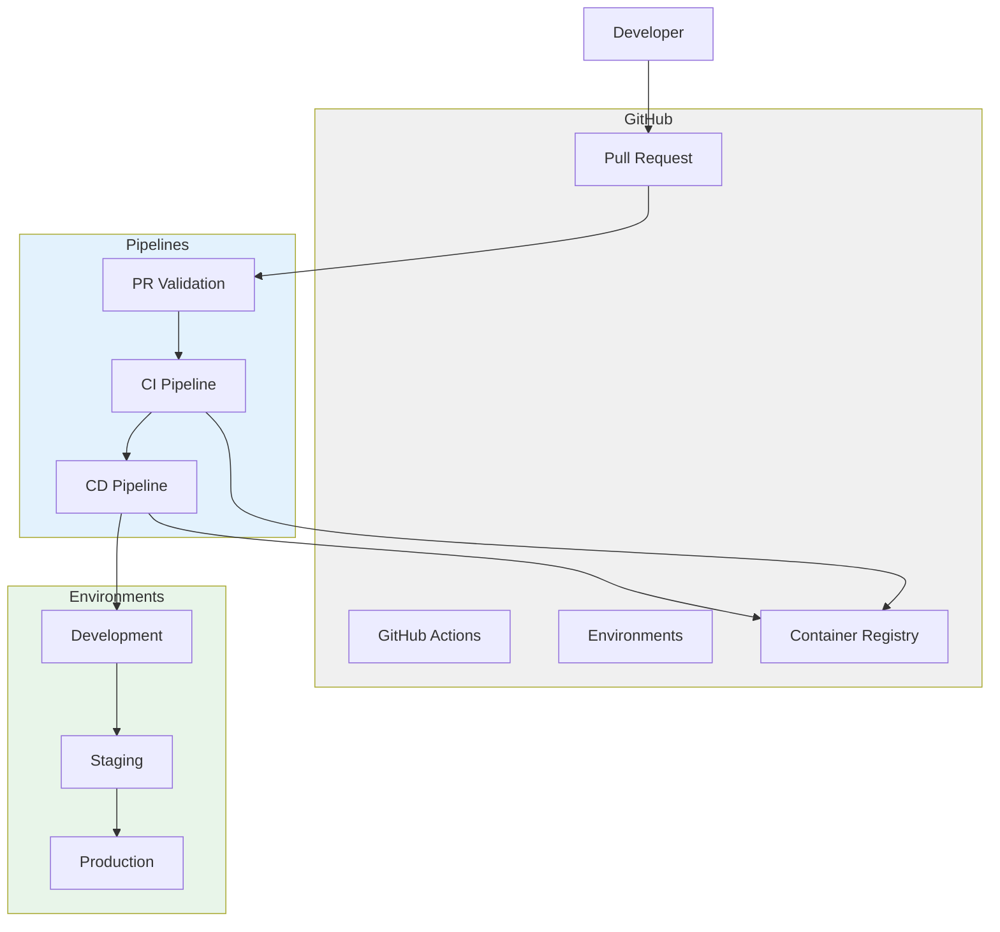

# 03 - GitHub Actions CI/CD

An Order Management API with a complete CI/CD pipeline using GitHub Actions.

[← Back to Portfolio](../)

## Overview

This project demonstrates practical CI/CD implementation using GitHub Actions. It includes:

- Pull Request validation pipeline
- Continuous Integration pipeline
- Continuous Deployment pipeline with environment promotion
- Docker containerization
- GitHub Environments with approval gates

## Architecture



## Pipeline Overview

### 1. PR Validation (`pr-validation.yml`)
Triggers on every pull request:
- Build solution
- Run unit tests
- Check code formatting
- Validate no breaking changes

### 2. CI Pipeline (`ci.yml`)
Triggers on merge to `main`:
- Build and test
- Build Docker image
- Push to container registry
- Run integration tests

### 3. CD Pipeline (`cd.yml`)
Triggers after CI success:
- Deploy to Development (auto)
- Deploy to Staging (auto)
- Deploy to Production (manual approval)

## Project Structure

```
02-github-actions-cicd/
├── .github/
│   └── workflows/
│       ├── pr-validation.yml
│       ├── ci.yml
│       └── cd.yml
├── src/
│   └── OrderApi/
│       ├── Controllers/
│       ├── Data/
│       ├── Models/
│       └── Program.cs
├── tests/
│   └── OrderApi.Tests/
├── Dockerfile
└── OrderApi.csproj
```

## Environment Promotion

```
┌─────────────┐    ┌─────────────┐    ┌─────────────┐
│ Development │───▶│  Staging    │───▶│ Production  │
│ (Auto)      │    │  (Auto)     │    │ (Manual)    │
└─────────────┘    └─────────────┘    └─────────────┘
```

| Environment | Trigger | Approval | URL |
|-------------|---------|----------|-----|
| Development | Auto on merge | None | dev.example.com |
| Staging | Auto after Dev | None | staging.example.com |
| Production | Manual gate | Required | example.com |

## Key Features

| Feature | Implementation |
|---------|---------------|
| PR Validation | Build + test on every PR |
| Auto Deployment | CD triggers after CI passes |
| Approval Gates | Production requires manual approval |
| Docker Build | Multi-stage Dockerfile |
| Environment Secrets | Secure credentials per environment |
| Rollback | Revert to previous Docker image |

## Tech Stack

- .NET 9
- GitHub Actions
- Docker + GitHub Container Registry
- xUnit + FluentAssertions
- SQLite

## Source Code

Full implementation: [`02-github-actions-cicd/`](../../02-github-actions-cicd/)
