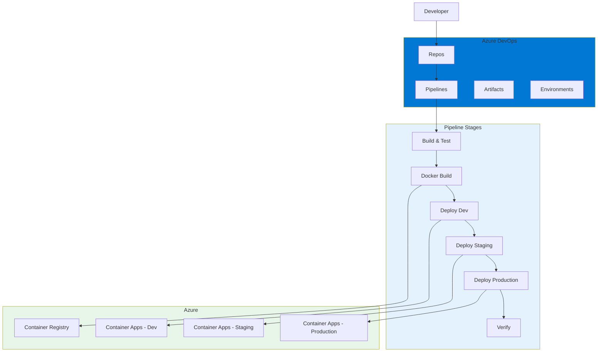

# 04 - Azure DevOps CI/CD

A Customer Management API demonstrating enterprise-grade CI/CD using Azure DevOps Pipelines.

[← Back to Portfolio](../)

## Overview

This project demonstrates enterprise-grade CI/CD using Azure DevOps Pipelines. It includes:

- Multi-stage YAML pipeline
- Variable groups and secure variables
- Environment promotion (Dev → Staging → Production)
- Approval gates for production deployments
- Docker containerization
- Azure Container Apps deployment

## Architecture



## Pipeline Stages

```mermaid
graph LR
    subgraph Stage1["Stage 1: Build"]
        B1[dotnet restore]
        B2[dotnet build]
        B3[dotnet test]
        B4[dotnet publish]
    end
    
    subgraph Stage2["Stage 2: Docker"]
        D1[Build Image]
        D2[Push to ACR]
    end
    
    subgraph Stage3["Stage 3: Deploy Dev"]
        DV1[Deploy to Dev]
        DV2[Smoke Tests]
    end
    
    subgraph Stage4["Stage 4: Deploy Staging"]
        S1[Deploy to Staging]
        S2[Integration Tests]
    end
    
    subgraph Stage5["Stage 5: Deploy Production"]
        P1[Approval Gate]
        P2[Deploy to Prod]
        P3[Health Check]
    end
    
    Stage1 --> Stage2
    Stage2 --> Stage3
    Stage3 --> Stage4
    Stage4 --> Stage5
```



## Project Structure

```
03-azure-devops-cicd/
├── azure-pipelines.yml
├── src/
│   └── CustomerApi/
│       ├── Controllers/
│       ├── Data/
│       ├── Models/
│       └── Program.cs
├── tests/
│   └── CustomerApi.Tests/
├── Dockerfile
├── docker-compose.yml
└── CustomerApi.csproj
```

## Pipeline Configuration

### Variable Groups
| Group | Purpose |
|-------|---------|
| `dev-variables` | Development environment settings |
| `staging-variables` | Staging environment settings |
| `prod-variables` | Production environment settings |
| `docker-variables` | Docker build configuration |

### Approval Gates
| Environment | Gate Type | Approvers |
|-------------|-----------|-----------|
| Development | None | Auto-deploy |
| Staging | Check | Team lead |
| Production | Approval | Release manager + QA |

## Azure Resources

| Resource | Purpose |
|----------|---------|
| Azure Container Registry | Docker image storage |
| Azure Container Apps (Dev) | Development hosting |
| Azure Container Apps (Staging) | Pre-production testing |
| Azure Container Apps (Production) | Live hosting |
| Azure Key Vault | Secrets management |

## Key Features

| Feature | Implementation |
|---------|---------------|
| Multi-stage YAML | Single pipeline file for all stages |
| Variable Groups | Centralized configuration |
| Approval Gates | Manual approval for production |
| Docker Build | Multi-stage Dockerfile |
| Azure Container Apps | Serverless container hosting |
| Health Checks | Post-deployment verification |

## Tech Stack

- .NET 9
- Azure DevOps Pipelines
- Docker + Azure Container Registry
- Azure Container Apps
- Azure Key Vault
- xUnit + FluentAssertions
- SQLite

## Source Code

Full implementation: [`03-azure-devops-cicd/`](../../03-azure-devops-cicd/)
