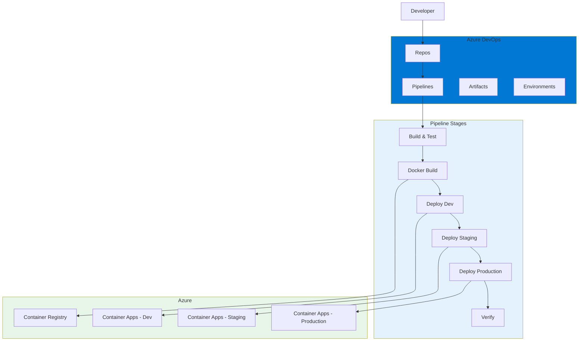
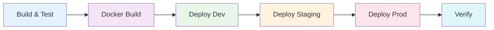
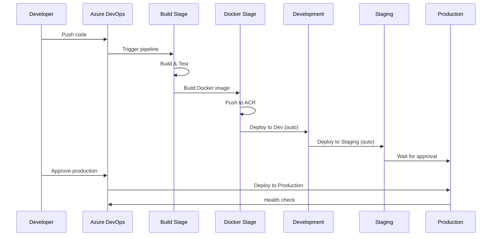

# Azure DevOps CI/CD - Customer API

A production-style .NET 9 Customer Management API demonstrating enterprise CI/CD implementation with Azure DevOps.

## Overview

This project demonstrates enterprise-grade CI/CD using Azure DevOps Pipelines. It includes:

- Multi-stage YAML pipeline
- Variable groups and secure variables
- Environment promotion (Dev → Staging → Production)
- Approval gates for production deployments
- Docker containerization
- Azure Container Apps deployment

## Architecture



## Project Structure

```
03-azure-devops-cicd/
├── azure-pipelines.yml          # Multi-stage pipeline
├── src/
│   └── CustomerApi/
│       ├── Controllers/         # API endpoints
│       ├── Data/                # EF Core DbContext
│       ├── DTOs/                # Data Transfer Objects
│       ├── Middleware/           # Exception handling, Correlation ID
│       └── Models/              # Entities
├── tests/
│   └── CustomerApi.Tests/       # Unit tests
├── docs/
│   └── decisions/               # ADRs
├── Dockerfile                   # Multi-stage build
├── docker-compose.yml           # Local development
└── README.md
```

## Azure DevOps Pipeline

### Pipeline Stages



### Stage Details

#### 1. Build and Test
- Install .NET SDK
- Restore NuGet packages
- Build solution
- Run unit tests with code coverage
- Publish test results
- Create build artifact

#### 2. Docker Build
- Build Docker image
- Push to Azure Container Registry
- Tag with build ID and latest

#### 3. Deploy Development
- Auto-deploy after Docker build
- Deploy to Azure Container Apps
- Run database migrations

#### 4. Deploy Staging
- Deploy to staging environment
- Validation testing

#### 5. Deploy Production
- Requires approval gate
- Deploy to production environment
- Blue-green deployment support

#### 6. Post-deployment Verification
- Health check
- Smoke tests

### Variables

```yaml
variables:
  buildConfiguration: 'Release'
  dotnetVersion: '9.0.x'
  azureSubscription: '$(AZURE_SUBSCRIPTION)'
  containerRegistry: '$(CONTAINER_REGISTRY)'
  imageRepository: 'customer-api'
  tag: '$(Build.BuildId)'
```

### Environments

| Environment | Approval | Auto-deploy |
|-------------|----------|-------------|
| Development | None | Yes |
| Staging | None | Yes |
| Production | Required | No |

### Mermaid Pipeline Diagram



## Azure Resources

### Required Azure Resources

| Resource | Purpose | SKU |
|----------|---------|-----|
| Azure Container Registry | Store Docker images | Basic |
| Azure Container Apps | Host API | Consumption |
| Azure SQL Database | Data storage | Basic |
| Application Insights | Monitoring | Basic |

### Resource Group Structure

```
rg-customer-api-dev
├── acr-customer-api
├── ca-customer-api
├── sql-customer-api
└── ai-customer-api

rg-customer-api-staging
├── acr-customer-api
├── ca-customer-api
├── sql-customer-api
└── ai-customer-api

rg-customer-api-prod
├── acr-customer-api
├── ca-customer-api
├── sql-customer-api
└── ai-customer-api
```

## API Endpoints

| Method | Endpoint | Description |
|--------|----------|-------------|
| GET | /api/customers | List all customers |
| GET | /api/customers/{id} | Get customer by ID |
| POST | /api/customers | Create customer |
| PUT | /api/customers/{id} | Update customer |
| DELETE | /api/customers/{id} | Soft delete customer |
| GET | /health | Health check |

## Getting Started

### Prerequisites

- .NET 9 SDK
- Docker (optional)
- Azure account (for deployment)
- Azure DevOps organization

### Local Development

```bash
# Clone repository
git clone <repo-url>
cd 03-azure-devops-cicd

# Run with Docker
docker compose up

# Or run directly
dotnet run --project src/CustomerApi
```

### Azure Setup

1. Create Azure DevOps organization
2. Create project and import repository
3. Create service connections
4. Create variable groups
5. Create environments (dev, staging, production)
6. Configure approval gates for production

### Azure Resources Setup

```bash
# Login to Azure
az login

# Create resource groups
az group create --name rg-customer-api-dev --location eastus
az group create --name rg-customer-api-staging --location eastus
az group create --name rg-customer-api-prod --location eastus

# Create container registry
az acr create --resource-group rg-customer-api-dev --name custapiacr --sku Basic

# Create container apps environment
az containerapp env create --name cae-dev --resource-group rg-customer-api-dev --location eastus
```

## Interview Discussion Points

1. **Why multi-stage pipeline?**
   - Separates build from deployment
   - Different approval requirements per stage
   - Clear audit trail

2. **Why approval gates?**
   - Prevents accidental production deployments
   - Ensures human oversight
   - Compliance requirement

3. **Why variable groups?**
   - Centralized configuration
   - Environment-specific values
   - Secure variable storage

4. **How to handle secrets?**
   - Azure DevOps variable groups
   - Azure Key Vault integration
   - Never commit to repository

5. **Rollback strategy?**
   - Keep previous Docker image tagged
   - Deploy previous version
   - Database migration rollback

## Possible Improvements

- Add SonarQube integration
- Add security scanning (OWASP)
- Add performance testing stage
- Implement canary deployments
- Add monitoring and alerting
- Implement blue-green deployments
- Add database migration automation

## License

MIT License - see [LICENSE](LICENSE)
