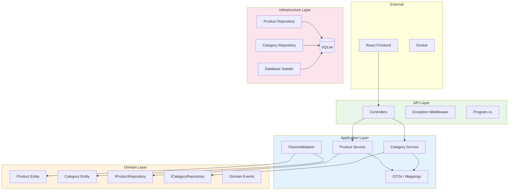

# Clean Architecture Diagram

## Dependency Flow

## Key Principles

- **Dependency Inversion**: Domain defines interfaces, Infrastructure implements them
- **Separation of Concerns**: Each layer has a single responsibility
- **Testability**: Business logic is pure and easily unit tested
- **Independence**: Domain layer has zero external dependencies
