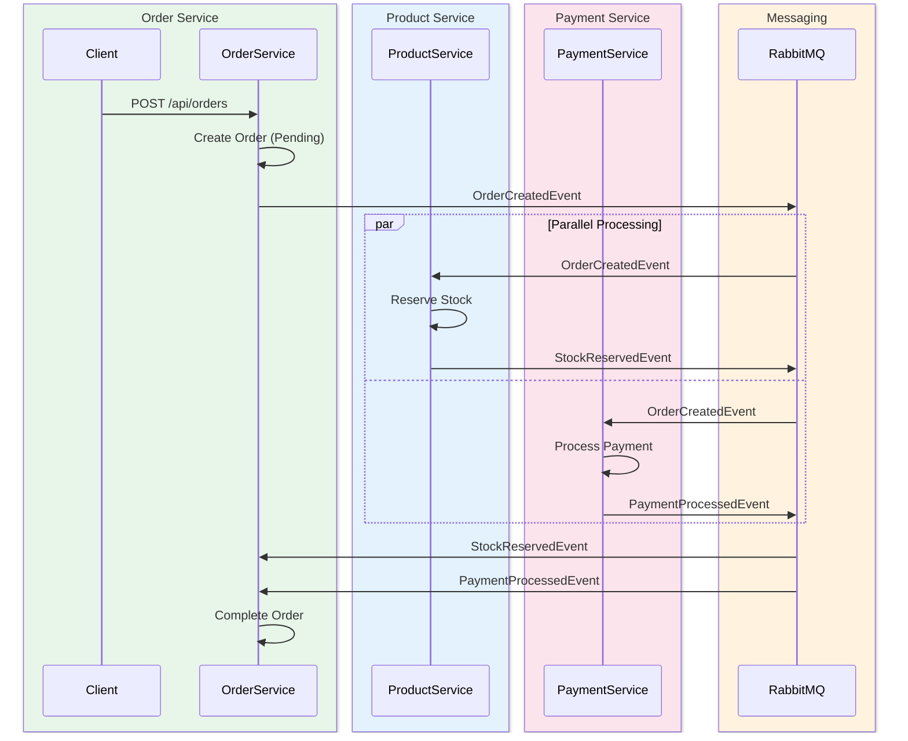
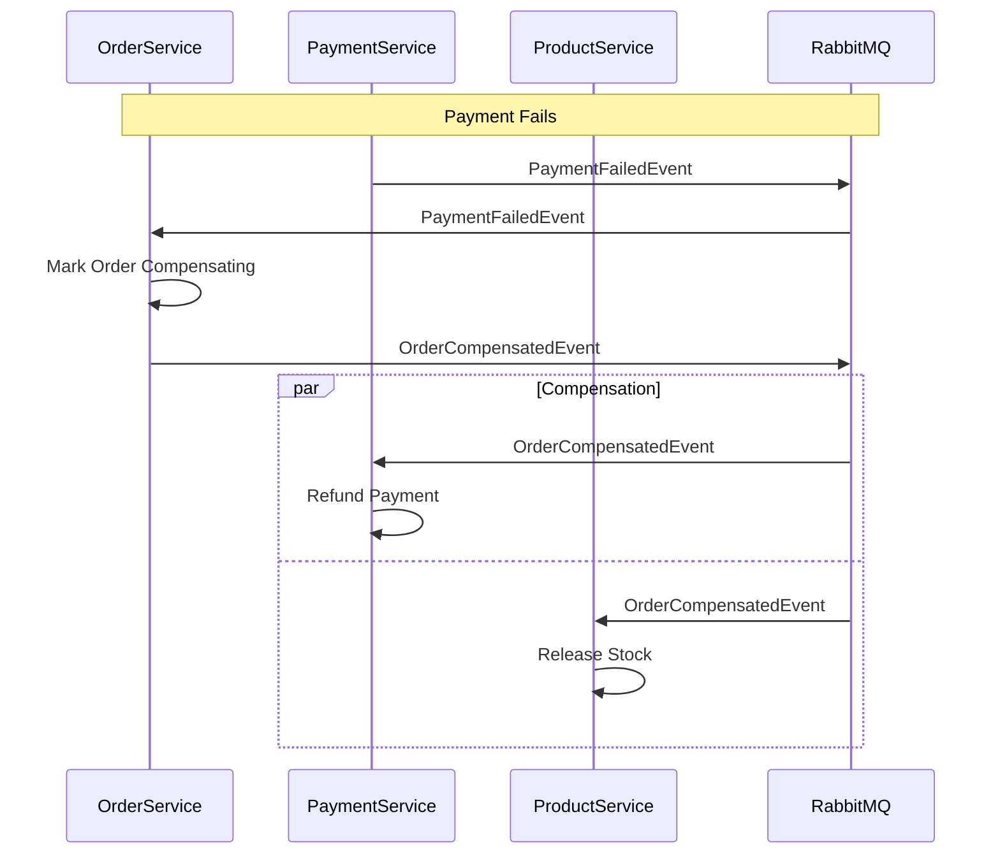

# Microservices Architecture Diagram

## Service Topology

```mermaid
graph TB
    subgraph Clients
        React[React Frontend :3000]
    end

    subgraph Gateway
        YARP[API Gateway :5000]
    end

    subgraph Services
        PS[Product Service :5001]
        OS[Order Service :5002]
        PmS[Payment Service :5003]
    end

    subgraph Databases[(Database Per Service)]
        DB1[(products.db)]
        DB2[(orders.db)]
        DB3[(payments.db)]
    end

    subgraph Messaging
        RMQ[RabbitMQ :5672]
        Mgmt[RabbitMQ Mgmt :15672]
    end

    React --> YARP
    YARP --> PS
    YARP --> OS
    YARP --> PmS

    PS --> DB1
    OS --> DB2
    PmS --> DB3

    OS -->|Publish| RMQ
    PS -->|Publish| RMQ
    PmS -->|Publish| RMQ
    RMQ -->|Consume| PS
    RMQ -->|Consume| OS
    RMQ -->|Consume| PmS
    RMQ --> Mgmt
```

## Saga Event Flow



## Compensation Flow


